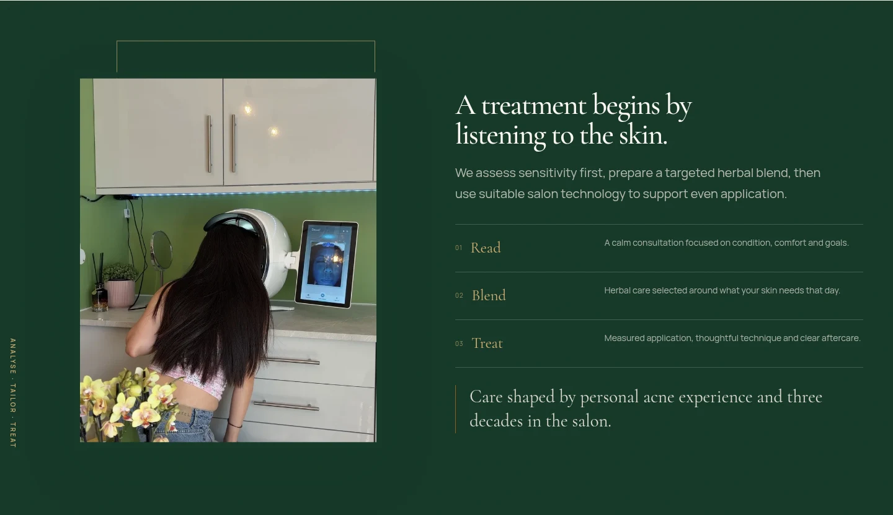

# Hailey Beauty

**Thirty years of Hong Kong facial practice, now tailoring herbal care for London skin.**

The website for Hailey Beauty, an independent herbal facial studio in Oxford Circus. It is a single-page site with the full treatment menu and prices, live booking through SumUp, a before/after results gallery, and complete English, Mandarin and Cantonese versions.

Live at **[hailey-beauty.pages.dev](https://hailey-beauty.pages.dev)**

<p align="center">
  
</p>

<p align="center">
  
  
</p>

## What the site does

**A menu that answers questions before they are asked.** Every facial, package and waxing service lists its length, price and what the treatment involves, grouped into Signature Facials, Advanced Treatment, Packages, Waxing and Male Waxing.

**Three languages, not three pages.** English, 普通話 and 廣東話 are switched in the header and applied across every heading, price, booking label and footer note, so the whole page changes rather than a subset.

**Booking where the customer already is.** The Book Now buttons hand off to SumUp Bookings, which owns live availability and payment. The site never stores a customer record.

**Proof, not claims.** A before/after gallery of real client results in a gently auto-scrolling carousel that pauses on hover and can be dragged, alongside short treatment notes and aftercare.

**Findable.** Local business structured data, canonical URLs, a Google Maps embed with opening hours, and social links to Instagram, TikTok, Rednote and Facebook.

## Design

Bone, forest green and brass, with a Cormorant Garamond display face over Manrope body text. The layout is built around a printed-menu feel: hairline rules, small caps labels, numbered sections, and generous whitespace. Motion is limited to gentle reveals, and the whole site respects `prefers-reduced-motion`.

## Tech

- Static HTML, CSS and vanilla JavaScript — no framework
- Chinese type set in Noto Sans/Serif SC and TC alongside the Latin faces
- Booking through SumUp Bookings; map through Google Maps
- Cloudflare Pages, with Pages Functions and a D1 database for first-party traffic analytics
- A small Node build step that copies the static files into `.dist` and writes route and security headers
- A Supabase Edge Function (`supabase/functions/studio`) that redirects `/studio/whatsapp` to the studio's WhatsApp link

```
index.html            the whole page
styles.css            design system and layout
script.js             translations, gallery, booking links, structured data
analytics-tracker.js  privacy-friendly pageview and booking-click events
analytics/            first-party traffic dashboard (noindex)
functions/api/        Pages Functions that record and summarise events
lib/                  analytics storage and aggregation helpers
migrations/           D1 schema for analytics events
scripts/              build, Cloudflare setup, browser verification
assets/               photography, before/after pairs, logo, price list PDF
docs/screenshots/     README images
```

## Run it locally

```bash
npm install
npm run dev
```

That builds the site into `.dist` and serves it with Wrangler on `http://localhost:5181`, including the Pages Functions.

```bash
npm run build     # build .dist
npm test          # unit tests
npm run deploy    # build and deploy to Cloudflare Pages
```

The analytics endpoints need a D1 database bound as `ANALYTICS_DB`; without it, the site still renders and simply returns "analytics is not configured". If you only want the marketing site, any static server pointed at the repository root also works.

## Editing content

- **Prices and treatments** live in the markup in `index.html`, one card per service.
- **Translations** live in the `copy` objects at the top of `script.js`, keyed `en`, `zh` and `yue`.
- **Booking, social and canonical URLs** are in `SITE_CONFIG` at the top of `script.js`.
- **Photography** goes in `assets/`; the before/after pairs follow the `ba-NN.webp` naming pattern.

## Analytics

Pageviews and booking clicks are recorded first-hand in Cloudflare D1: path, referrer, campaign parameters, country, city, device, browser, screen size, language and timezone. No cookies are used for advertising and no data is sold or shared. Visitors can be seen in aggregate at `/analytics`.

Client records, bookings and payments are not part of this codebase — SumUp owns the booking flow.
